  

  
  
  

**Readable systems. Testable gameplay.** 
출시한 게임을 업데이트로 계속 다듬어 온 Unity 클라이언트 개발자입니다.
모바일 퍼즐 게임을 Android와 iOS에 출시한 뒤에도 업데이트와 후속작 개발을 이어 왔고, 팀 프로젝트에서는 UI와 몬스터, 전투 구역 진행을 맡았습니다.

### Projects

| 프로젝트 | 맡은 일 | 상태 |
|---|---|---|
| **In to the Stella** | 6인 팀, UI 7종, 일반 몬스터 6종, 전투 구역 진행 | - |
| **케이팝 천지인** | 3인 팀, 프로그래밍 전담, 한글 조합 퍼즐, 결제와 광고 연동 | Android, iOS 출시 |
| **숫자전쟁** | 7인 팀, 게임플레이, 컴퓨터 상대, 방 상태 연동 디버깅 | 퇴사 후 팀 출시 |
| **Pixel Gun Master** | 인턴, 몬스터 상태 이상, Perk 25종 | 인턴 기간 중 팀이 Steam 얼리 액세스 출시 |

회사와 팀 프로젝트의 원본 코드는 공개할 수 없습니다.
포트폴리오에서 설명한 기능을 독립적으로 다시 구현한 예시 코드와 테스트는 **[unity-portfolio-samples](https://github.com/WI-GEON/unity-portfolio-samples)** 에 있습니다.

### Code Samples

- **[unity-portfolio-samples](https://github.com/WI-GEON/unity-portfolio-samples)** — 상태 이상, Perk 인터페이스, 방 상태 동기화, 한글 조합, CSV 검증 / EditMode 테스트 42개

### Toolbox

Unity, C#, VContainer, UniTask, Addressables, Unity Test Framework, Rider, Visual Studio, Git, GitHub
