  

  
  

**Readable systems. Testable gameplay.**
모바일 게임을 혼자 출시해 본 경험 위에, 팀 프로젝트의 UI · 몬스터 · 전투 시스템을 끝까지 만들어 온 Unity 클라이언트 개발자입니다.

### Projects

| 프로젝트 | 맡은 일 | 상태 |
|---|---|---|
| **In to the Stella** | 6인 팀 · UI 7종 · 몬스터 공통 기반 · 전투 진행 | 개발 중단 · 미출시 |
| **케이팝 천지인** | 1인 프로그래머 · 한글 조합 퍼즐 · 결제 · 광고 연동 | Android / iOS 출시 |
| **숫자전쟁** | 7인 팀 · 게임플레이 · Computer Mode · 방 상태 연동 디버깅 | 퇴사 후 팀 출시 |
| **Pixel Gun Master** | 인턴 · 몬스터 상태 이상 · Perk 25종 | 인턴 종료 후 팀 얼리 액세스 |

회사 · 팀 프로젝트의 원본 코드는 공개할 수 없습니다.
같은 동작을 다시 작성한 대체 코드와 테스트는 **[unity-portfolio-samples](https://github.com/WI-GEON/unity-portfolio-samples)** 에 있습니다.

### Code Samples

- **[unity-portfolio-samples](https://github.com/WI-GEON/unity-portfolio-samples)** — 상태 이상 · Perk 인터페이스 · 방 상태 동기화 · 한글 조합 · CSV 검증 / EditMode 테스트 42개

### Toolbox

Unity · C# · VContainer · UniTask · Addressables · Unity Test Framework · Rider · Visual Studio · Git · GitHub
